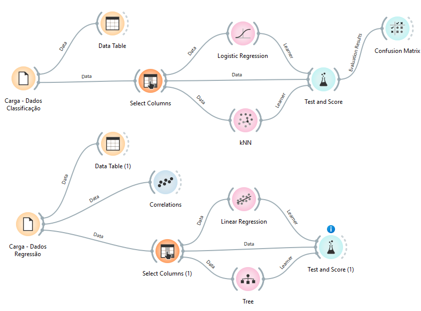

# CP5 — APIs de Energia Renovável e Aprendizado de Máquina

## 👥 Integrantes

| Nome | RM |
|---|---|
| Arthur Costa | 569976 |
| Guilherme Detta | 569666 |
| Henrique Bolfer | 569514 |
| Igor Alves | 574127 |
| Pedro Arthur | 569913 |

---

## 🎯 Objetivo

Consumir duas APIs públicas de dados de energia e clima, organizar as respostas em arquivos CSV e resolver duas tarefas de aprendizado de máquina, comparando **três algoritmos em cada uma**:

1. **Classificação (ANEEL):** a partir da potência e da localização de um empreendimento, classificar sua fonte como **Solar, Eólica ou Hidráulica**.
2. **Regressão (Open-Meteo):** a partir das condições meteorológicas e da hora local em **Petrolina (PE)**, estimar a **radiação solar horizontal** (W/m²).

---

## 📁 Estrutura do repositório

```
CP5/
├── CP5.ipynb                          # Notebook com consulta às APIs, análise e modelos
├── README.md
├── dataset/
│   ├── aneel_classificacao_orange.csv # Dados da tarefa de classificação
│   └── meteo_regressao_orange.csv     # Dados da tarefa de regressão
└── img/
    └── orange_workflow.png            # Fluxo montado no Orange Data Mining
```

---

## 🌐 Fontes e período dos dados

| Tarefa | Fonte | Acesso | Recorte |
|---|---|---|---|
| Classificação | [ANEEL — SIGA](https://dadosabertos.aneel.gov.br/dataset/siga-sistema-de-informacoes-de-geracao-da-aneel) (API CKAN/DataStore, recurso `11ec447d-698d-4ab8-977f-b424d5deee6a`) | Público, sem token | Tipos `UFV`, `EOL`, `UHE`, `PCH`, `CGH` — até 1.200 registros por tipo |
| Regressão | [Open-Meteo — Historical Weather API](https://open-meteo.com/en/docs/historical-weather-api) | Público, sem token | Lat. `-9.39`, Lon. `-40.50` (Petrolina/PE), **01/04/2025 a 30/06/2025**, fuso `America/Recife`, horas das 7h às 17h |

> Os dados do Open-Meteo são estimativas de modelos/reanálise, não leituras de um sensor específico. As quantidades da ANEEL são limitadas por tipo e **não** representam a participação real de cada fonte na matriz brasileira.

### `dataset/aneel_classificacao_orange.csv` — 3.876 linhas

| Coluna | Descrição | Papel |
|---|---|---|
| `potencia_kw` | Potência outorgada (kW) | Entrada (X) |
| `latitude` | Latitude do empreendimento (graus decimais) | Entrada (X) |
| `longitude` | Longitude do empreendimento (graus decimais) | Entrada (X) |
| `fonte` | Solar (`UFV`), Eólica (`EOL`) ou Hidráulica (`UHE`+`PCH`+`CGH`) | Alvo (y) |

Distribuição das classes: **Hidráulica 1.476 · Solar 1.200 · Eólica 1.200** (desequilíbrio leve). Nenhum valor ausente. Campos que revelariam a classe (`SigTipoGeracao`, `CodCEG`, nome, combustível) **não** foram usados como entrada.

### `dataset/meteo_regressao_orange.csv` — 1.001 linhas

| Coluna | Descrição | Papel |
|---|---|---|
| `data_hora` | Data e hora local | Ordenação/divisão temporal |
| `temperatura_c` | Temperatura a 2 m (°C) | Entrada (X) |
| `umidade_pct` | Umidade relativa a 2 m (%) | Entrada (X) |
| `nuvens_pct` | Cobertura de nuvens (%) | Entrada (X) |
| `vento_kmh` | Velocidade do vento a 10 m (km/h) | Entrada (X) |
| `hora` | Hora local (7 a 17) | Entrada (X) |
| `radiacao_w_m2` | Radiação global horizontal média da hora anterior (W/m²) | Alvo (y) |

---

## ▶️ Como executar

1. Clone o repositório:
   ```bash
   git clone <url-do-repositorio>
   cd CP5
   ```
2. Instale as dependências (Python 3.9+):
   ```bash
   pip install pandas numpy matplotlib scikit-learn jupyter
   ```
3. Abra e rode o notebook **na ordem das células**:
   ```bash
   jupyter notebook CP5.ipynb
   ```

As células de consulta às APIs baixam os dados novamente e regravam os CSVs em `dataset/`. Sem internet, basta pular essas células: a análise lê os CSVs já incluídos na pasta `dataset/`.

---

## 🤖 Tarefa 1 — Classificação (ANEEL)

**Metodologia:** divisão treino/teste **estratificada 80/20** (`random_state=42`) — 3.100 amostras de treino e 776 de teste. A padronização (`StandardScaler`) fica dentro de um `Pipeline`, sendo ajustada **somente no treino**.

| Modelo | Por que foi escolhido |
|---|---|
| Regressão Logística | Modelo linear simples, serve de linha de base |
| KNN (k=5) | Aproveita a proximidade geográfica entre empreendimentos da mesma fonte |
| Random Forest (100 árvores) | Captura relações não lineares e interações entre potência e localização, sem precisar de escala |

### Resultados (conjunto de teste, média `macro`)

| Modelo | Accuracy | Precision | Recall | F1 |
|---|---|---|---|---|
| **Random Forest** | **0,9755** | **0,9769** | **0,9741** | **0,9753** |
| KNN | 0,9652 | 0,9663 | 0,9636 | 0,9648 |
| Regressão Logística | 0,8247 | 0,8282 | 0,8214 | 0,8197 |


### Interpretação

- O **Random Forest** foi o escolhido, com o maior F1 macro (0,975). A média `macro` dá o mesmo peso às três classes, o que é adequado diante do leve desequilíbrio.
- Na matriz de confusão do Random Forest, a classe que mais erra é a **Solar**: 7 casos previstos como Hidráulica e 5 como Eólica. A Eólica teve 4 casos confundidos com Hidráulica.
- A Regressão Logística fica bem abaixo porque as fronteiras entre as fontes no espaço potência × latitude × longitude não são lineares (por exemplo, eólicas concentradas no litoral do Nordeste e no Sul, hidráulicas espalhadas ao longo dos rios).
- **Limitação:** potência e localização não bastam para uma aplicação real. Fontes diferentes podem coexistir na mesma região com faixas de potência parecidas, e o bom desempenho aqui depende do recorte da amostra (limite de registros por tipo). Informações técnicas adicionais seriam necessárias, mas o enunciado restringe as entradas a essas três variáveis.

---

## ☀️ Tarefa 2 — Regressão (Open-Meteo)

**Metodologia:** divisão **temporal, sem embaralhar**. As primeiras 80% das horas vão para treino (800 linhas, até 12/06/2025 14h) e as 20% finais para teste (201 linhas, a partir de 12/06/2025 15h). A escala é ajustada apenas no treino via `Pipeline`.

| Modelo | Por que foi escolhido |
|---|---|
| Regressão Linear | Linha de base simples e interpretável |
| Random Forest Regressor (100 árvores) | Modela a relação não linear entre hora, nuvens e radiação |
| SVR (kernel RBF) | Alternativa não linear baseada em kernel |

### Resultados (conjunto de teste)

| Modelo | MAE (W/m²) | MSE ((W/m²)²) | R² |
|---|---|---|---|
| **Random Forest** | **66,80** | **7.307,42** | **0,8442** |
| Regressão Linear | 145,20 | 30.034,20 | 0,3598 |
| SVR | 181,09 | 47.441,64 | -0,0112 |

### Interpretação

- O **Random Forest** teve o melhor desempenho: erra em média cerca de **67 W/m²** e explica ~84% da variação da radiação no período de teste.
- A **Regressão Linear** não consegue representar a curva diária da radiação, que sobe pela manhã, atinge o pico perto do meio-dia e cai à tarde. Uma relação linear com a hora não captura esse formato de "sino".
- O **SVR** com hiperparâmetros padrão (`C=1`) ficou praticamente no nível de prever a média (R² ≈ 0), pois a regularização é forte demais para um alvo na escala de centenas de W/m². Ajustar `C` e `epsilon` provavelmente melhoraria o resultado.
- **Peso da hora:** é a variável mais importante para o Random Forest (≈ 49% da importância), seguida da temperatura (≈ 30%). A posição do sol ao longo do dia define grande parte da radiação disponível; as variáveis meteorológicas ajustam esse nível.
- **Radiação ≠ energia gerada:** a radiação (W/m²) é a potência solar que chega a uma superfície horizontal. A energia produzida por um sistema fotovoltaico (kWh) depende também da área e da eficiência dos módulos, da orientação e inclinação, da temperatura das células, de sombreamento, sujeira e perdas do inversor e do cabeamento.

---

## 🍊 Validação complementar no Orange Data Mining



- **Classificação:** `File (Carga – Dados Classificação)` → `Select Columns` → `Logistic Regression` e `kNN` → `Test and Score` → `Confusion Matrix`, com um `Data Table` para inspeção dos dados.
- **Regressão:** `File (Carga – Dados Regressão)` → `Select Columns` → `Linear Regression` e `Tree` → `Test and Score`, com `Data Table` e `Correlations` para a análise exploratória.

O `Select Columns` define o alvo de cada fluxo (`fonte` e `radiacao_w_m2`) e mantém como entradas as mesmas variáveis usadas no notebook.

---

## ✅ Conclusão

| Tarefa | Melhor modelo | Métrica principal |
|---|---|---|
| Classificação (fonte do empreendimento) | Random Forest | F1 macro = 0,975 |
| Regressão (radiação em Petrolina) | Random Forest | MAE = 66,8 W/m² · R² = 0,844 |

Nas duas tarefas, o modelo baseado em árvores superou as alternativas lineares porque as relações entre as entradas e o alvo são claramente não lineares.
